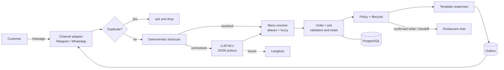

# pedidos-bot

A conversational assistant that takes restaurant orders over chat and hands the cashier a clean, structured order ready to validate.

> Status: **development phase, milestone M2 (engine with simulated LLM)**. See [ROADMAP.md](ROADMAP.md).

## Vision

In many neighborhood burger joints in Colombia, 100% of orders arrive over WhatsApp, and the person answering the chat is the same person running the register. Each order is 10–20 back-and-forth messages, with data arriving out of order ("2 sencillas, una sin cebolla, y una coca grande... ah, y a la calle 10").

`pedidos-bot` handles that conversation in informal Colombian Spanish, validates everything against the restaurant's menu, computes the total and gives the cashier **a summary ready to confirm**. If it doesn't understand, the customer asks for a person, or a voice note arrives, it hands the chat over to a human.

Principles:

- **The LLM interprets, the code decides.** The model extracts actions from text; prices, products and totals come only from the restaurant's configuration.
- **No restaurant in the core.** Everything restaurant-specific lives in a per-restaurant YAML file.
- **Swappable channel and model.** Telegram in development, WhatsApp as the target; Qwen3 4B locally today, a hosted model if evaluation justifies it.
- **Measurable.** Every turn is traced; every order has a cost and a token count.

## Architecture



Details and rejected alternatives: [ADR-0001](docs/adr/0001-architecture-action-nlu.md), [ADR-0002](docs/adr/0002-postgresql-persistence.md), [ADR-0003](docs/adr/0003-observability-langfuse.md).

## Running it

Requirements: [uv](https://docs.astral.sh/uv/) and, for the local model, [Ollama](https://ollama.com) with `qwen3:4b`. Docker (PostgreSQL, Langfuse) is needed from M3/M5 on.

```bash
uv sync
cp .env.example .env   # fill in the values
uv run pytest
uv run pedidos-bot config validate config/restaurants/*.yaml
uv run pedidos-bot resolve --restaurant burger_demo "malteda de fresa"
uv run pedidos-bot chat --restaurant burger_demo
```

Restaurant configs live in `config/restaurants/<id>.yaml` and are validated against [docs/config.schema.json](docs/config.schema.json) (editors with YAML language support autocomplete from it). Commands to chat with the bot (terminal REPL and Telegram) arrive in milestones M2 and M4.

## Metrics

Published here with real numbers from M5/M6 on: % of orders completed without human intervention, item and modifier accuracy, escalation rate, p50/p95 latency, tokens and cost per order — comparing the local model against hosted models.

## Language

The repository's working language is English (code, docs, issues, commits). The bot itself speaks Colombian Spanish, so customer-facing templates, prompts, restaurant configs and evaluation conversations are in Spanish.

## Documentation

- [ROADMAP.md](ROADMAP.md) — phases and milestones
- [docs/adr/](docs/adr/) — architecture decision records
- [docs/dev-notes/](docs/dev-notes/) — per-milestone log
- [CLAUDE.md](CLAUDE.md) — project conventions

## License

MIT
