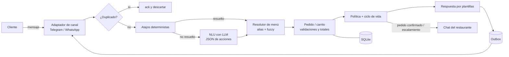

# pedidos-bot

Asistente conversacional que toma pedidos de restaurantes por chat y entrega a la caja un pedido limpio, estructurado y listo para validar.

> Estado: **fase de desarrollo, hito M0 (fundaciones)**. Ver [ROADMAP.md](ROADMAP.md).

## Visión

En muchas hamburgueserías de barrio el 100 % de los pedidos entra por WhatsApp, y quien responde el chat es la misma persona que atiende la caja. Cada pedido son 10–20 mensajes de ida y vuelta, con datos que llegan desordenados ("2 sencillas, una sin cebolla, y una coca grande... ah, y a la calle 10").

`pedidos-bot` atiende esa conversación en español colombiano informal, valida todo contra el menú del restaurante, calcula el total y le entrega a la cajera **un resumen listo para confirmar**. Si no entiende, el cliente pide una persona o llega una nota de voz, pasa el chat a un humano.

Principios:

- **El LLM interpreta, el código decide.** El modelo extrae acciones del texto; precios, productos y totales salen sólo de la configuración del restaurante.
- **Nada de restaurantes en el núcleo.** Todo lo específico vive en un YAML por restaurante.
- **Canal y modelo intercambiables.** Telegram en desarrollo, WhatsApp como destino; Qwen3 4B local hoy, modelo hospedado si la evaluación lo justifica.
- **Medible.** Cada turno se traza; cada pedido tiene costo y tokens.

## Arquitectura



Detalle y alternativas descartadas en [docs/adr/0001-arquitectura-nlu-de-acciones.md](docs/adr/0001-arquitectura-nlu-de-acciones.md).

## Cómo correrlo

Requisitos: [uv](https://docs.astral.sh/uv/) y, para el modelo local, [Ollama](https://ollama.com) con `qwen3:4b`.

```bash
uv sync
cp .env.example .env   # completa los valores
uv run pytest
uv run pedidos-bot --help
```

Los comandos para chatear con el bot (REPL y Telegram) llegan en los hitos M2 y M4.

## Métricas

Se publicarán aquí con números reales a partir del hito M5/M6: % de pedidos completos sin intervención humana, exactitud de ítems y modificadores, tasa de escalamiento, latencia p50/p95, tokens y costo por pedido, comparando el modelo local contra modelos hospedados.

## Documentación

- [ROADMAP.md](ROADMAP.md) — fases e hitos
- [docs/adr/](docs/adr/) — decisiones de arquitectura
- [docs/dev-notes/](docs/dev-notes/) — bitácora por hito
- [CLAUDE.md](CLAUDE.md) — convenciones del proyecto

## Licencia

MIT
